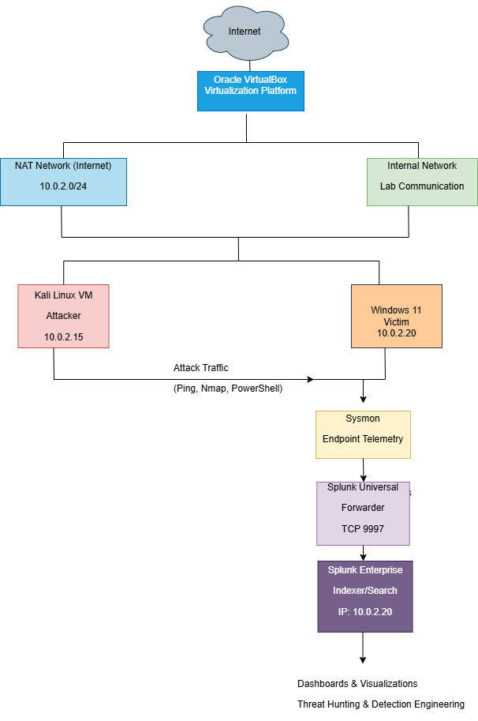
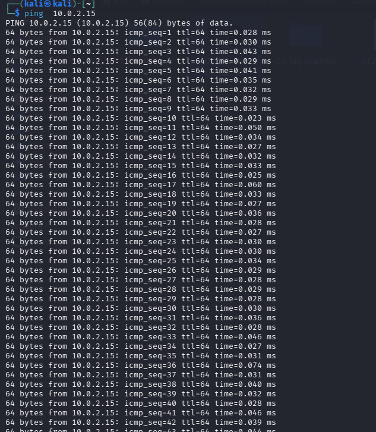

# SOC Home Lab Setup

## Objective

Build a SOC Home Lab that is capable of  generating, collecting, detecting, and investigating security events.

#Environment:

Attacker:
Kali Linux

Victim:
Windows 11

Virtualization:
Oracle VirtualBox

Network:
NAT  Network
Internal Network

## DATA FLOW

        Kali Linux

            │

            │ Attack Simulation

            ▼

      Windows 11 Endpoint

            │    Sysmon generates telemetry

            ▼

         Sysmon

            │

            ▼

    Windows Event Logs

            │Splunk reads local event logs

            ▼

    Splunk Universal Forwarder

        TCP 9997

            │

            ▼

          Search

            ↓

       Detection Rule

            ↓

          Alert

            ↓

      Investigation

## Lab Components

| System        | Purpose            |
|---------------|--------------------|
| Kali Linux    | Attacker Machine   |
| Windows 10 VM | Target Endpoint    |
| Sysmon        | Endpoint Telemetry |
| Splunk        | SIEM Platform      |

## Validation:
Ping test successful.
- ping-test.png

Successful ICMP connectivity confirms communication between the Kali Linux attacker machine and the Windows endpoint over the Internal Network.

## Architecture Diagram

- network-diagram.png

| Asset      | IP Address | Role     |
|------------|------------|----------|
| Kali Linux | 10.0.2.15  | Attacker |
| Windows VM | 10.0.2.15  | Target   |
| Splunk     | x.x.x.x    | SIEM     |

## Evidence
- kali-ip.png
- windows11-ip.png

The Kali Linux VM is connected to both the NAT Network for Internet access and the Internal Network for communication with the Windows endpoint.

The Windows 10 VM hosts both Sysmon and Splunk Enterprise, serving as the monitored endpoint and SIEM platform.
